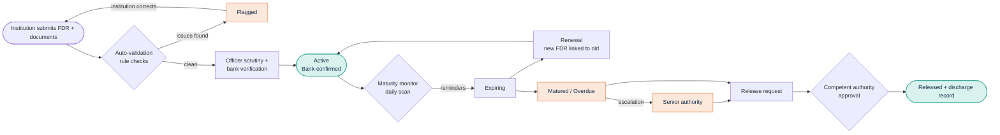
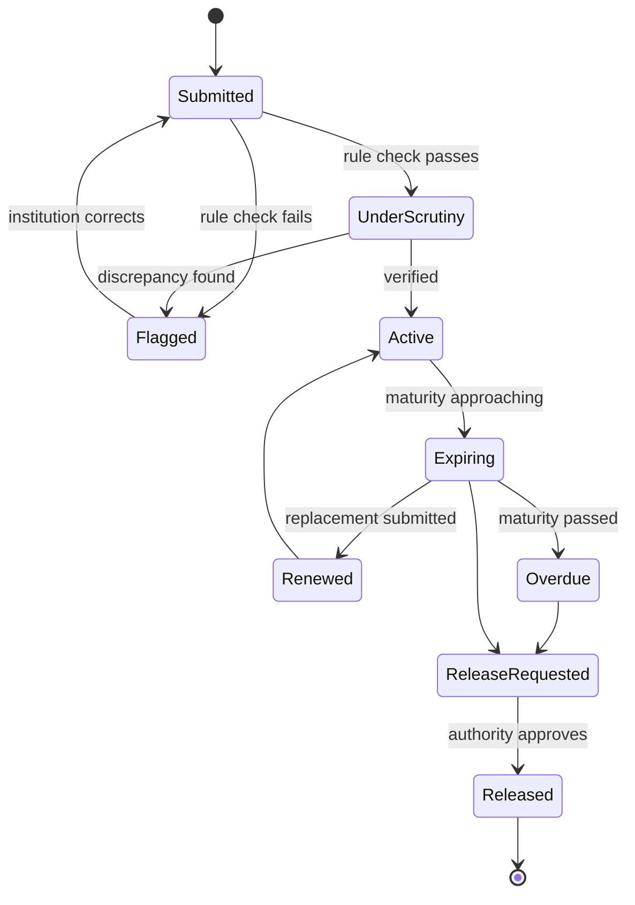
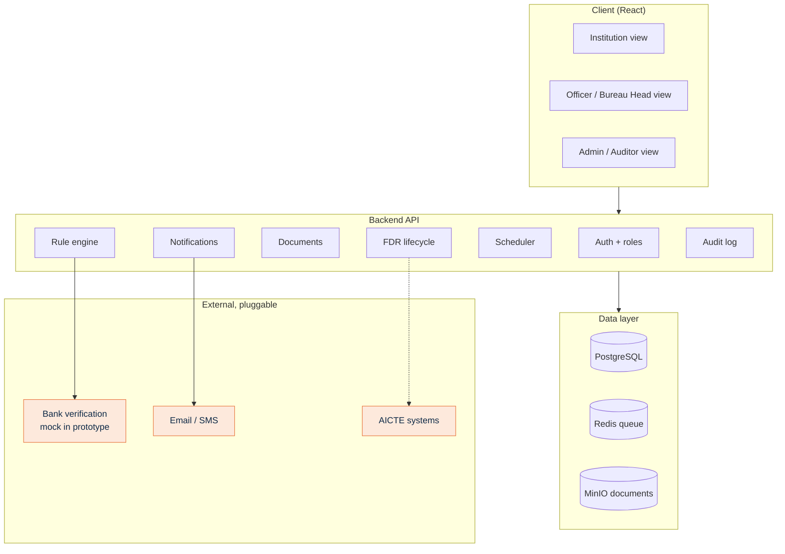

 

**One portal for every security deposit and FDR, from submission to release.**

[The problem](#-the-problem) · [Our solution](#-our-solution) · [How it works](#-how-it-works) · [Architecture](#-architecture) · [Run it](#-run-it-locally) · [Roadmap](#-roadmap)

---

## 🎯 The problem

AICTE asks some technical institutions to lock money with it as a guarantee, usually as a bank **Fixed Deposit Receipt (FDR)**. Today these are tracked through scattered records, letters, emails and separate trackers.

That makes it hard to answer simple questions:

| Question an officer needs answered | What goes wrong today |
|---|---|
| Which FDRs are about to mature? | Dates sit in spreadsheets and files, so deadlines get missed. |
| Is this instrument genuine and complete? | Verification is manual, and claimed data is not separated from bank-confirmed data. |
| Which institutions are waiting for a refund? | Requests arrive by email with no status trail. |
| Who changed what, and when? | No single audit history. |

> **Why it keeps getting bigger:** [342 AICTE-approved institutions closed over three years](https://news.careers360.com/342-aicte-approved-technical-institutions-shut-lok-sabha-reply), and every closure is a deposit to locate, verify and release.

---

## 💡 Our solution

**NIDHIVA** is a secure, centralized portal that manages the whole life of every deposit.

<table>
<tr>
<td width="33%" valign="top">

### 📥 Submit
Institutions upload FDR details and documents online instead of sending letters.

</td>
<td width="33%" valign="top">

### 🔍 Verify
Automatic rule checks flag problems, and every record is tagged **submitted** or **bank-confirmed**.

</td>
<td width="33%" valign="top">

### ⏰ Track
Daily maturity monitoring sends reminders and escalates anything overdue.

</td>
</tr>
<tr>
<td valign="top">

### 🔁 Renew
A replacement FDR is linked to the old one, and the full history is kept.

</td>
<td valign="top">

### 📤 Release
Release and refund requests move through officer review to the competent authority.

</td>
<td valign="top">

### 📊 Oversee
A live dashboard and automated reports show every instrument and pending case.

</td>
</tr>
</table>

### What makes it different

- **Trust tagging:** institution-submitted and bank-confirmed data are never mixed up.
- **Rule-based discrepancy engine:** catches date errors, duplicates, missing documents and expired instruments before an officer spends time on them.
- **SLA-based escalation:** alerts cover stalled verifications and unresolved cases, not only maturity dates.
- **Pluggable bank verification:** a mock service today, swappable for real bank APIs once authorized.
- **Full audit trail:** every submission, change and approval is traceable.

---

## 🔄 How it works

### Lifecycle of an FDR

### Status states

### Test scenarios from the problem statement

| # | Scenario | Where to see it in the demo |
|---|---|---|
| 1 | New FDR submission | Institution view → *New deposit* |
| 2 | Validity tracking | Dashboard → *Active* |
| 3 | Approaching maturity | Dashboard → *Expiring* and alerts |
| 4 | Renewal | FDR detail → *Renewal history* |
| 5 | Discrepancy identification | Flagged list with reasons |
| 6 | Authorized release processing | Release request → approval |

---

## 🏗 Architecture

> **Honest note:** bank verification is **simulated** in this prototype behind a clean interface. It is built to be replaced with real bank or NeSL-style verification APIs when formally authorized.

### Tech stack

<!-- TODO: remove any badge for a technology you did not actually use. -->

---

## 🖼 Screenshots

<!-- TODO: add real screenshots to /docs/screenshots and update the paths below. -->

| Dashboard | New FDR submission |
|---|---|
|  |  |

| Discrepancy flags | Release workflow |
|---|---|
|  |  |

🎥 **Demo video:** <!-- TODO: paste YouTube link -->

---

## 🗺 Roadmap

<!-- TODO: tick only what actually works in your prototype. -->

- [ ] Institution view: FDR submission and document upload
- [ ] Rule-based discrepancy checks
- [ ] Officer scrutiny with submitted vs bank-confirmed tagging
- [ ] Maturity tracking with configurable reminders
- [ ] Renewal linking with history
- [ ] Release and refund approval workflow
- [ ] Dashboard and automated reports
- [ ] Role-based access and audit trail
- [ ] Real bank verification API integration *(needs formal authorization)*
- [ ] Integration with existing AICTE systems *(needs formal authorization)*

---

## 📈 Target impact

> These are **projected design targets**, to be measured in the prototype, not measured results.

| Area | Target |
|---|---|
| Administrative and paperwork cost | 30-40% reduction |
| Manual verification and tracking time | 50-60% reduction |
| Unnoticed maturities | Zero, through alerts at 90/30/15/7/1 days plus overdue escalation |

---

## 📚 References

1. AICTE, *Approval Process Handbook 2024-25 to 2026-27*, [aicte.gov.in](https://aicte.gov.in/sites/default/files/APH%20Final.pdf)
2. Careers360, [*Closures of AICTE-approved institutions (Lok Sabha reply)*](https://news.careers360.com/342-aicte-approved-technical-institutions-shut-lok-sabha-reply)
3. NeSL e-Bank Guarantee platform, cited as a precedent for digital verification of bank instruments (it covers bank guarantees, not FDRs)

---

👥 Team

	
Project	NIDHIVA
Competition	Smart India Hackathon 2026
Problem Statement	SIH26265
Domain Smart Automation
Team name	555_ATHENA

---

Built for **Smart India Hackathon 2026** · Problem Statement **26265**

